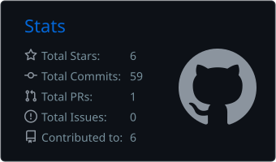
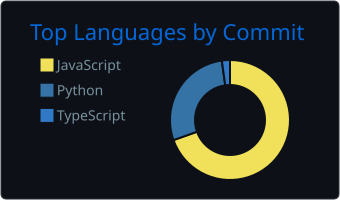
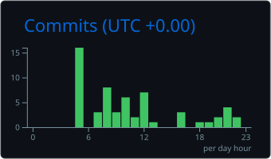

<!-- ============ HEADER ============ -->
<div align="center">


</div>

<!-- ============ HERO: portrait + intro, aligned in one row ============ -->
<table align="center">
  <tr>
    <td width="400" align="center" valign="middle">
      
    </td>
    <td align="left" valign="middle">
      <a href="https://git.io/typing-svg">
        
      </a>
      <br/><br/>
      
      
      
      <br/><br/>
      <a href="https://my-portfolio-ashy-xi-32.vercel.app/"></a>
      <a href="https://www.linkedin.com/in/swapnil-arya-657589387/"></a>
      <a href="mailto:swapnilaryajua@gmail.com"></a>
    </td>
  </tr>
</table>

<br/>

<!-- ============ ABOUT ============ -->
## `> whoami`

```bash
$ cat about.txt

  name         : Swapnil Arya
  education    : B.Tech (3rd year) @ Jaypee University
  domain       : Agentic AI + Cybersecurity
  focus        : AI that solves real, practical problems
  achievements : 3 hackathon podium finishes
  status       : shipping, breaking things, securing them
```

I build AI-powered systems that protect people online: scanners, detectors and multi-agent defenders. I work across full-stack platforms and hardware-integrated projects, and I like turning a hackathon idea into something people can actually use.

<br/>

<!-- ============ FEATURED ============ -->
## `> featured_project`

<h1 align="center"><a href="https://github.com/swapnilaryajua-lgtm/Rakshak">RAKSHAK</a></h1>
<p align="center"><sub>Cybersecurity SaaS for Indian website owners &nbsp;|&nbsp; Hack &amp; Build 2026</sub></p>

**Rakshak** is a cybersecurity platform that helps website owners in India find and fix security problems.

- **Vulnerability scanner:** scan a site and get findings with severity levels.
- **Real-time monitoring:** a downloadable Windows app that watches your website.
- **Active defense:** attack blocking, attacker IP tracing and incident reports for cybercrime authorities.
- **Alerts:** Slack, Gmail and GitHub notifications for critical findings.

`React` `Tailwind` `FastAPI` `PostgreSQL` `OWASP ZAP` `PySide6`

<div align="right"><a href="https://github.com/swapnilaryajua-lgtm/Rakshak">View repository &rarr;</a></div>

<br/>

<!-- ============ PROJECTS ============ -->
## `> other_projects`

<table>
  <tr>
    <td width="50%" valign="top">
      <h3>Satya AI</h3>
      <p><b>The Truth Engine.</b> A multilingual misinformation detection platform covering fake news, deepfakes and app malware scanning.</p>
      <p>Presented at CodeSrijan 2026 and CodeStorm 2026.</p>
      <a href="https://github.com/swapnilaryajua-lgtm/Satya-ai">
        
      </a>
    </td>
    <td width="50%" valign="top">
      <h3>CheckIt</h3>
      <p><b>Your Cyber Warrior.</b> Deepfake detection for images, video and audio, with built-in cybercrime and cyberbullying reporting.</p>
      <p>Built at DevGathering 2K26.</p>
      <a href="https://github.com/swapnilaryajua-lgtm/check-it">
        
      </a>
    </td>
  </tr>
</table>

<br/>

<!-- ============ ACHIEVEMENTS ============ -->
## `> achievements`

| Result | Hackathon | Details |
|:--|:--|:--|
| 🥇 **1st Place** | **Hacking Hills** | JUET Waknaghat, Solan (national level) |
| 🥈 **1st Runner-Up** | **JAI 2026 Hackathon** | JIIT, Sector 128, Noida (cybersecurity domain) |
| 🥉 **2nd Runner-Up** | **Cordstrom 2026** | Hosted by Tech4Hack |

<br/>

<!-- ============ TECH STACK ============ -->
## `> tech_stack`

<div align="center">


<br/>


</div>

<br/>

<!-- ============ STATS ============ -->
## `> github_stats`

<div align="center">




<br/>


</div>

<br/>

<!-- ============ ACTIVITY ============ -->
## `> activity`

<div align="center">



</div>

<br/>

<!-- ============ SNAKE ============ -->
<div align="center">

<picture>
  <source media="(prefers-color-scheme: dark)" srcset="https://raw.githubusercontent.com/swapnilaryajua-lgtm/swapnilaryajua-lgtm/output/github-snake-dark.svg" />
  <source media="(prefers-color-scheme: light)" srcset="https://raw.githubusercontent.com/swapnilaryajua-lgtm/swapnilaryajua-lgtm/output/github-snake.svg" />
  
</picture>

</div>

<br/>

<!-- ============ CONTACT ============ -->
## `> connect`

<div align="center">

**Open to collaborations, hackathon teams and security projects.**

<a href="https://my-portfolio-ashy-xi-32.vercel.app/"></a>
<a href="https://www.linkedin.com/in/swapnil-arya-657589387/"></a>
<a href="mailto:swapnilaryajua@gmail.com"></a>


</div>
